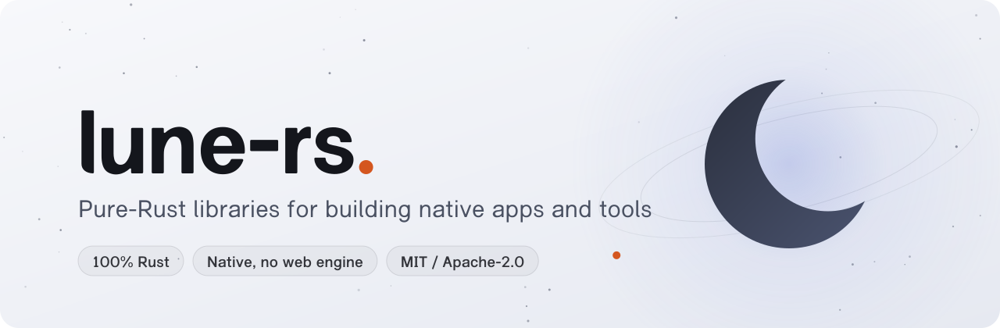
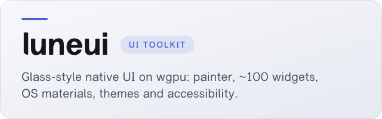
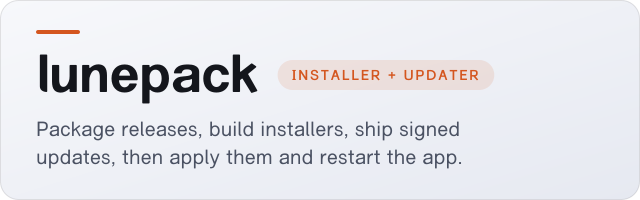
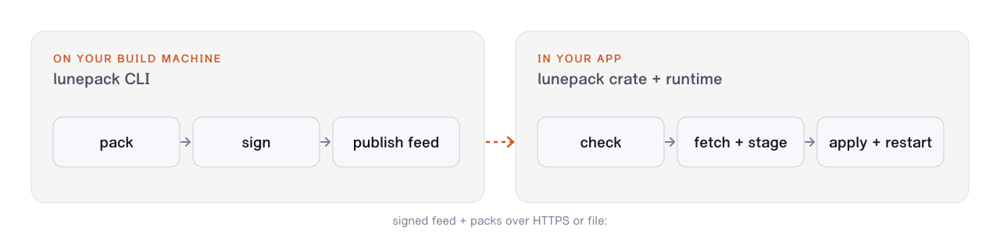

<!-- Assets are generated by scripts/gen-assets.py (RznSans text outlined to paths). -->
<p align="center">
  <picture>
    <source media="(prefers-color-scheme: dark)" srcset="https://raw.githubusercontent.com/lune-rs/.github/main/profile/assets/banner-dark.svg">
    
  </picture>
</p>

<p align="center">
  <a href="#-libraries"><b>Libraries</b></a> ·
  <a href="#-how-it-fits-together"><b>How it fits together</b></a> ·
  <a href="#-design-principles"><b>Principles</b></a> ·
  <a href="#-using-a-library"><b>Using a library</b></a>
</p>

<p align="center">
  
  
  
  
</p>

**lune-rs** is a family of Rust libraries that power a set of native desktop apps and developer
tools: the shared foundations that would otherwise be rewritten in every app. Each library is
written purely in Rust, keeps its core free of I/O so it can be tested without a GPU, a network or a
real filesystem, and is app-agnostic: nothing in a library knows which app is using it.

The libraries grew out of real apps (the **Lunegit** git client and the **Luneterm** terminal) and
were extracted so that every new app and tool can start from the same parts.

## 📦 Libraries

| Library | What it is | Highlights | Platforms |
|---|---|---|---|
| [**luneui**](https://github.com/lune-rs/luneui) | Native glass UI toolkit | wgpu painter · ~100 widgets · OS glass · themes · AccessKit | macOS · Windows, Linux (build-checked) |
| [**lunepack**](https://github.com/lune-rs/lunepack) | Installer, packager and auto-updater | signed feeds · resumable downloads · rollback · native installers | Linux · Windows · macOS (newest) |

---

<a href="https://github.com/lune-rs/luneui">
  <picture>
    <source media="(prefers-color-scheme: dark)" srcset="https://raw.githubusercontent.com/lune-rs/.github/main/profile/assets/luneui-dark.svg">
    
  </picture>
</a>

A UI toolkit for glass-style desktop apps: an immediate-mode painter on [wgpu](https://wgpu.rs),
close to 100 catalogued components, OS glass materials, window helpers and theme tokens.
**No web engine and no CSS** — styles are Rust values.

<p align="center">
  
</p>

<table>
  <tr>
    <td width="50%"><br><sub><b>Controls</b> — buttons, toggles, fields, steppers</sub></td>
    <td width="50%"><br><sub><b>Tree view</b> — keyboard focus and states built in</sub></td>
  </tr>
  <tr>
    <td width="50%"><br><sub><b>Dialogs</b> — stacked glass frosts what is behind it</sub></td>
    <td width="50%"><br><sub><b>Search</b> — the command palette and filtering</sub></td>
  </tr>
</table>

- 🎨 **Painter and display list** — rounded fills, strokes, paths, text, images and glass, recorded into a `Scene` and drawn by wgpu. Frames are deterministic.
- 🧩 **Widgets** — fields, a code editor, markdown, a diff view, tables, tree views, tabs, menus, dialogs, popovers, toasts, a command palette, a lane graph and more. All with focus, disabled states, motion tiers and an accessibility tree.
- 🪟 **Glass** — every in-window surface frosts the content behind it; the window itself can use macOS vibrancy or Windows acrylic / Mica.
- 🌗 **Themes** — one `Theme` value colours everything; load one from JSON or use the built-in dark preset.
- 🖥️ **Platform pieces** — caption buttons, window edges, a tray item with its popover, clipboard.

```bash
git clone https://github.com/lune-rs/luneui && cd luneui
cargo run -p gallery     # every component, live, with knobs
```

---

<a href="https://github.com/lune-rs/lunepack">
  <picture>
    <source media="(prefers-color-scheme: dark)" srcset="https://raw.githubusercontent.com/lune-rs/.github/main/profile/assets/lunepack-dark.svg">
    
  </picture>
</a>

A pure-Rust framework for shipping desktop apps: package a release, sign it, publish a feed, and
let the app check, download, stage and apply the update itself — then restart into the new version,
and roll back if it does not come up healthy.

<p align="center">
  <picture>
    <source media="(prefers-color-scheme: dark)" srcset="https://raw.githubusercontent.com/lune-rs/.github/main/profile/assets/lunepack-flow-dark.svg">
    
  </picture>
</p>

- 🔐 **Trust first** — signed feeds and manifests (Ed25519, DSSE envelopes), root key rotation, freshness and rollback floors, with a written [threat model](https://github.com/lune-rs/lunepack/blob/main/docs/THREAT-MODEL.md).
- 📦 **Packager CLI** — `lunepack init`, `keys`, `pack`, `feed`, `verify`, `inspect`, `setup`; works on any app's build output and verifies every file it writes.
- ⬇️ **Update client** — `check`, `download`, `stage` as executor-agnostic futures (tokio, smol or none), resumable range downloads, cancel at any point, crash-safe state.
- 🔁 **Apply and restart** — a small runtime swaps versions, supervises the new one and rolls back if it fails.
- 💿 **Installers** — Linux setup files, Windows per-user installs with a launcher stub, macOS `.dmg` / `.zip` bundles, with an install UI drawn by **luneui**.

```bash
git clone https://github.com/lune-rs/lunepack && cd lunepack
cargo run -p lunepack-cli -- --help
```

## 🧭 How it fits together

```
          your app / tool
        ┌───────┴────────┐
        ▼                ▼
     luneui  ◀──────  lunepack        (lunepack's installer and update screens
   (the UI)         (ship + update)    are drawn with luneui)
```

Apps depend on the libraries, never the other way round. Inside each library the same shape repeats:
a **core** of pure logic, **adapters** for the GPU, the OS, the network and the filesystem, and a
**facade** crate that apps import.

## 🧱 Design principles

| | |
|---|---|
| 🦀 **Purely Rust** | No web engine and no C++ UI framework. `unsafe` lives only in the small OS adapter crates, each block with a `// SAFETY:` note. |
| 🧪 **Pure cores, swappable adapters** | Cores never read the clock, the environment, the network or the disk. Every seam has a fake and a contract test, so widgets and update flows are tested without a GPU or a server. |
| 🎯 **Deterministic** | The same input gives the same frame, the same pack and the same bytes. In luneui, every drawing change must pass a pixel gate over rendered scenes. |
| 🧭 **App-agnostic** | No app or domain words in library code, and dependency directions are fixed; both are enforced by boundary checks. |
| 📝 **Decisions written down** | Each repo keeps `docs/STATE.md` (where things are), `docs/DECISIONS.md` (what was decided and why) and an architecture doc — readable by people and coding agents alike. |

## 🚀 Using a library

The libraries are **not on crates.io yet** (APIs still move). Depend on them by git:

```toml
[dependencies]
lune-ui  = { git = "https://github.com/lune-rs/luneui" }
lunepack = { git = "https://github.com/lune-rs/lunepack" }
```

Each repo's README covers its toolchain, build gate and integration guide —
for example luneui's [`docs/consuming.md`](https://github.com/lune-rs/luneui/blob/main/docs/consuming.md).

## 📄 License

Everything here is dual-licensed under **MIT** or **Apache-2.0**, at your option.

<p align="center"><sub>🌙 <i>lune</i> — French for “moon”.</sub></p>
